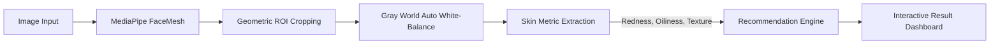

# Mobile Skin Diagnostic & Recommendation Engine

[](https://react.dev/)
[](https://vitejs.dev/)
[](https://developers.google.com/mediapipe)
[](#architecture)
[](https://opensource.org/licenses/MIT)

An on-device, privacy-first computer vision and skin diagnostic web application. Developed as part of an edge-AI engineering initiative to perform real-time facial landmark detection, skin region-of-interest (ROI) extraction, lighting-normalized visual metric scoring, and personalized beauty-tech product recommendations—all without uploading photos to external cloud servers.

---

## 🌟 Key Features

- **100% Client-Side Privacy (Edge-AI)**: All computer vision math and face detection execute directly inside the user's browser runtime. Zero images or biometric data leave the device.
- **MediaPipe 468-Point Face Mesh**: Maps dense 3D facial topology locally to establish real-time facial alignment.
- **Dynamic Region of Interest (ROI) Extraction**: Mathematically crops key diagnostic skin patches (Forehead, Left Cheek, Right Cheek, Chin) based on landmark coordinate geometry while ignoring hair, clothing, and background noise.
- **Auto White-Balance (Gray World Normalization)**: Eliminates ambient lighting bias (such as warm incandescent bulbs or tinted shadows) prior to quantitative color evaluation.
- **Deterministic Skin Metric Scoring**:
  - **Redness / Erythema Index**: Analyzes red-channel dominance $R / (R + G + B)$ across cropped skin regions to detect irritation and inflammation.
  - **Oiliness / Specular Highlight Detection**: Evaluates specular reflection using luminance thresholding ($0.299R + 0.587G + 0.114B$) to gauge sebum levels.
  - **Texture & Surface Roughness**: Computes standard deviation of pixel grayscale variance to identify roughness, pores, and micro-relief.
- **Rule-Based Recommendation Engine**: Automatically evaluates diagnostic scores against tailored hardware device protocols (e.g. FOREO ESPADA, LUNA 4, UFO 3, BEAR) and custom skincare routines.

---

## 🏗️ Architecture Pipeline



1. **Capture / Upload**: User selects or provides an existing facial photograph.
2. **Landmark Detection**: Google MediaPipe Face Mesh detects and tracks 468 landmarks across the face.
3. **Region Cropping**: Canvas API crops high-fidelity square patches centered at:
   - Forehead (`Index 151`)
   - Left Cheek (`Index 205`)
   - Right Cheek (`Index 425`)
   - Chin (`Index 152`)
4. **Color Normalization**: Computes scene illuminant scaling factors to neutralize ambient color temperature.
5. **Feature Quantification**: Measures chromatic dominance, specular highlights, and luminance variance.
6. **Recommendation Output**: Matches skin profile with the optimal device and routine.

---

## 🚀 Getting Started

### Prerequisites

Ensure you have [Node.js](https://nodejs.org/) (v18 or higher) and `npm` installed.

### Installation

1. **Clone the repository:**
   ```bash
   git clone https://github.com/alanbodaubay/mobile-skin-diagnostic-engine.git
   cd mobile-skin-diagnostic-engine
   ```

2. **Install dependencies:**
   ```bash
   npm install
   ```

3. **Start local development server:**
   ```bash
   npm run dev
   ```

4. Open your browser and navigate to `http://localhost:5173` (or the URL displayed in your terminal).

---

## 📂 Project Structure

```
mobile-skin-diagnostic-engine/
├── index.html              # HTML entry point with MediaPipe CDN dependencies
├── package.json            # Project manifest, dependencies, and scripts
├── vite.config.js          # Vite build configuration
├── .gitignore              # Git ignore rules for node_modules, build, and OS artifacts
├── src/
│   ├── App.jsx             # Core application logic (MediaPipe, ROI math, scoring, rules)
│   ├── main.jsx            # React root mount
│   ├── index.css           # Global stylesheets
│   └── assets/             # Static graphics and icons
└── docs/
    └── Video_Script.md     # Presentation walkthrough script
```

---

## 🔬 Core Algorithms Explained

### 1. Auto White-Balance (Gray World Assumption)
Ambient light tints the skin (e.g. incandescent lighting artificially raises redness). The algorithm assumes the average scene reflection is achromatic:
$$\text{scale}_C = \frac{\text{avgGray}}{\text{avg}_C} \quad \text{where } C \in \{R, G, B\}$$
Each pixel is corrected prior to scoring: $C_{\text{corrected}} = \min(255, C \times \text{scale}_C)$.

### 2. Redness Ratio
Measures red concentration relative to total chromatic intensity:
$$\text{Ratio}_R = \frac{\bar{R}}{\bar{R} + \bar{G} + \bar{B}}$$
Baseline healthy skin falls between $0.38 - 0.42$; ratios $> 0.42$ indicate inflammation or erythema.

### 3. Texture Roughness (Luminance Standard Deviation)
Smooth skin exhibits uniform local illumination, whereas acne, scars, and rough texture produce high contrast micro-shadows:
$$\sigma = \sqrt{\frac{1}{N} \sum_{i=1}^{N} (Y_i - \bar{Y})^2}$$
where $Y = 0.299R + 0.587G + 0.114B$.

---

## 🗺️ Roadmap & Milestones

- [x] **Week 1-2**: Scope, Architecture & MediaPipe Landmarking Pipeline
- [x] **Week 3-4**: MVP Presentation & Region of Interest (ROI) Cropping (Forehead, Cheeks, Chin)
- [x] **Week 5**: Lighting-Resilient Color Normalizer (Gray World Assumption)
- [x] **Week 6 (Completed)**: On-Device TensorFlow.js Edge-AI Model & Offline FOREO Recommendation Engine
- [x] **Week 7 (Completed)**: Local IndexedDB Scan History, Longitudinal Progress Tracking & Before/After Comparison
- [ ] **Week 8**: Version 2.0 Live Presentation & Brand Styling Refinement
- [ ] **Week 9-10**: Edge Optimization (INT8) & Robustness Testing across Skin Tones
- [ ] **Week 11-12**: Final Mobile Packaging (PWA / Capacitor) & Internship Handover

---

## 📄 License

This project is open-source and licensed under the [MIT License](LICENSE).
